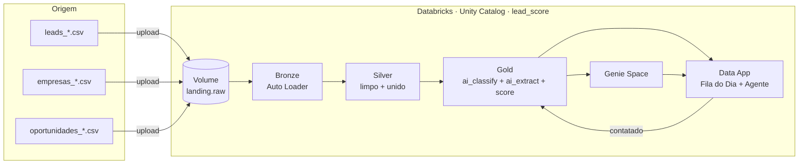

# PRD · Lead Score (V3)

> **100 leads por dia, capacidade para 20. Quais 20?**
> Priorização de leads com engenharia de dados + IA no Databricks, entregue ao time comercial como um Data App com agente conversacional.

| Campo | Valor |
|---|---|
| Projeto | **Lead Score** (antes "Call First") |
| Versão | **3.0** |
| Status | Especificado, aguardando desenvolvimento |
| Responsável | Alerrandro |
| Data | 22/11/2026 |
| Cliente (cenário) | Atlas Software, empresa fictícia de software B2B |
| Uso | Workshop de ~50 min para engenheiros e analistas de dados |
| Dados | `lead_score_dados.zip` (gerado por `gerar_csvs.py`, seed fixa) |

---

## 0 · O que muda da V2 para a V3

| Tema | V2 (Call First) | V3 (Lead Score) |
|---|---|---|
| Nome | Call First | **Lead Score** |
| Volume diário | 300 leads, capacidade de 20 (6,7%) | **100 leads, capacidade de 20 (20%)** |
| Catálogo | `call_first` | **`lead_score`** |
| Arquivo do dia | `leads_DEMO.csv` | **`leads_AAAA-MM-DD.csv`**, como uma exportação diária de verdade |
| Dataset | 300 linhas, 181 empresas | **100 linhas, 121 empresas**: mais fácil de mostrar e conferir ao vivo |
| Escopo da apresentação | Até o Data App + agente, sem backtest | Igual |

---

# FASE 1 · O PROBLEMA DE NEGÓCIO

## 1.1 Contexto

A Atlas Software vende cinco produtos por assinatura (Atlas Gestão, Atlas BI, Atlas Fiscal, Atlas CRM e Atlas Estoque). Chegam **cerca de 100 leads por dia** pelo site, LinkedIn, eventos, indicações e Google Ads.

O time comercial tem **4 vendedores**. Cada um consegue fazer cerca de **5 conversas de qualidade por dia**. Capacidade total: **20 leads por dia**.

**Objetivo do negócio: vender mais.**

## 1.2 A matemática que abre a apresentação

```
 100 leads chegam por dia
  20 leads são atendidos      →  20% da demanda
  80 leads ficam sem contato  →  80% da demanda
```

Para atender todo mundo, o time teria que ser **5 vezes maior**. Isso não vai acontecer. Então a pergunta muda de "como atender todo mundo?" para:

> ### **Se só posso falar com 20, como garanto que são os 20 certos?**

## 1.3 Declaração do problema

> **O time comercial escolhe os 20 leads do dia por ordem de chegada ou por intuição, lendo mensagem por mensagem. Leads prontos para comprar se perdem no meio de curiosos, pedidos de suporte e spam, e esfriam antes do contato. A conversão está em torno de 3%.**

## 1.4 Linha de base (hoje)

| Indicador | Hoje |
|---|---|
| Leads recebidos | ~100 por dia |
| Capacidade de contato | 20 por dia (4 vendedores × 5) |
| Critério de escolha | Ordem de chegada / intuição |
| Tempo gasto triando mensagens | ~30 min por vendedor por dia |
| Conversão dos leads contatados | ~3% |
| Vendas por dia (20 × 3%) | **~0,6** |

## 1.5 Causa-raiz (5 porquês)

1. **Por que vendemos pouco?** Porque boa parte dos 20 contatos do dia são leads que não iam comprar.
2. **Por que escolhemos os leads errados?** Porque a escolha é por ordem de chegada.
3. **Por que por ordem de chegada?** Porque não existe critério de prioridade.
4. **Por que não existe critério?** Porque o sinal de compra está **escondido em texto livre** ("preciso de 200 licenças até dezembro") e espalhado em arquivos diferentes (lead, empresa, histórico).
5. **Por que ninguém usa esse sinal?** Porque ler e comparar 100 mensagens por dia, cruzando com cadastro e histórico, não cabe na rotina de quem vende.

**Causa-raiz:** o sinal de compra existe, mas está em texto não estruturado e em fontes separadas. Falta um pipeline que **una os dados e transforme texto em atributo**.

## 1.6 Hipótese de valor

> **Se** unirmos os dados do lead, da empresa e do histórico comercial, **e** usarmos IA para transformar a mensagem livre em intenção e dados estruturados, **então** os 20 contatos diários irão para os leads com maior chance de compra, **e** as vendas sobem **sem aumentar o time**.

## 1.7 O tamanho do prêmio (cenário ilustrativo)

| Cenário | Leads contatados/dia | Conversão | Vendas/dia | Vendas/mês (22 dias úteis) |
|---|---|---|---|---|
| Hoje (ordem de chegada) | 20 | 3% | 0,6 | ~13 |
| Com Lead Score (meta) | 20 | 12% | 2,4 | ~53 |

> Mesmo time, mesma verba de marketing, **4× mais vendas**. O ganho vem só de escolher melhor.
> *(Números do cenário fictício, usados para dimensionar a oportunidade. A conversão real é medida em produção, com o feedback que os vendedores registram no app.)*

## 1.8 Stakeholders

| Persona | Necessidade | Decisão que o produto apoia |
|---|---|---|
| **Vendedor** | Saber para quem ligar e o que falar | Quais são os meus 5 leads de hoje |
| **Gestor comercial** | Distribuir a fila e acompanhar o resultado | Quem atende quem; o funil está saudável? |
| **Marketing** | Saber que canal traz comprador, não só volume | Onde investir a verba |
| **Engenharia/Analytics** | Pipeline simples, reprocessável e governado | Operação e evolução |

## 1.9 Métricas de sucesso

| Tipo | Métrica | Meta |
|---|---|---|
| ⭐ Negócio | Conversão dos 20 leads priorizados (medida em produção) | ≥ 12% (4× a linha de base) |
| Negócio | % da fila do dia ocupada por leads "compra imediata" | 100% quando houver ≥ 20 |
| Operação | Tempo de triagem por vendedor | De ~30 min para ~0 |
| Operação | Fila do dia disponível no app | Até 8h da manhã |
| IA | Acurácia do `ai_classify` contra o gabarito | ≥ 85% |
| Dados | Leads duplicados na Silver | 0 |

### ✅ Portão 1
- [x] Problema declarado em uma frase
- [x] Restrição de capacidade quantificada (100 → 20)
- [x] Linha de base e causa-raiz
- [x] Métricas com meta numérica

---

# FASE 2 · A SOLUÇÃO

## 2.1 Visão geral

```
 CSVs do dia ──► Volume "raw" ──► Bronze ──► Silver ──► Gold ──► Data App
 (lead, empresa,   (Unity          (cru)     (limpo,    (IA +     (Fila do Dia
  histórico)        Catalog)                  unido)     score)    + Agente)
                                                 │
                                    ai_classify + ai_extract
```

## 2.2 Escopo

**Dentro (MVP)**
- Ingestão incremental de CSVs a partir do Volume `raw`.
- Limpeza, deduplicação e junção das três fontes.
- `ai_classify` para a intenção e `ai_extract` para os dados escondidos na mensagem.
- **Lead Score** de 0 a 100, explicável, e a **Fila do Dia** com os 20 melhores.
- Data App com a fila por vendedor e um agente conversacional sobre os leads.

**Fora (próximas versões)**
- Integração direta com CRM, banco ou APIs.
- Texto gerado por LLM (`ai_query`) para resumo e abordagem.
- Escrita de volta no CRM e disparo automático de mensagens.
- Modelo de ML treinado com o histórico e backtest do score.

## 2.3 Histórias de usuário

| ID | Como... | Quero... | Para... |
|---|---|---|---|
| US-01 | vendedor | abrir o app e ver **meus 5 leads do dia** | não perder tempo triando |
| US-02 | vendedor | ver **por que** o lead está na fila e o que ele pediu | chegar na ligação preparado |
| US-03 | vendedor | marcar o lead como contatado | o gestor acompanhar sem planilha |
| US-04 | gestor | perguntar em português "quantos leads de compra imediata ficaram fora da fila hoje?" | decidir sem depender de analista |
| US-05 | marketing | perguntar "qual canal trouxe mais compra imediata?" | investir no canal certo |
| US-06 | eng. de dados | reprocessar um dia sem duplicar | operar com segurança |

## 2.4 Fontes de dados (CSV → Volume `raw`)

**Contexto:** todo dia os sistemas de origem (formulário do site, base cadastral e CRM) **exportam CSVs**, que são enviados ao Volume do Unity Catalog. A partir daí, tudo acontece no Databricks.

**Local:** `/Volumes/lead_score/landing/raw/`

| Pasta | Arquivo | Origem simulada | Conteúdo | Chave |
|---|---|---|---|---|
| `leads/` | `leads_AAAA-MM-DD.csv` | Formulário do site, LinkedIn, eventos, Google Ads | `lead_id`, nome, e-mail, telefone, cnpj, canal, campanha, **mensagem (texto livre)**, `recebido_em` | `lead_id`, e-mail |
| `empresas/` | `empresas_AAAA-MM-DD.csv` | Base cadastral | cnpj, razão social, porte, segmento, nº de funcionários, UF | cnpj |
| `historico/` | `oportunidades_AAAA-MM-DD.csv` | Exportação do CRM | oportunidade_id, cnpj, produto, status (ganha/perdida/aberta), valor, data | oportunidade_id |

### O dataset do workshop

| Arquivo | Linhas | Quando subir |
|---|---|---|
| `empresas_2026-11-22.csv` | 121 empresas | Antes da demo |
| `oportunidades_2026-11-22.csv` | 119 oportunidades (49 ganhas, 56 perdidas, 14 abertas) | Antes da demo |
| `leads_2026-11-22.csv` | 100 linhas → **96 leads únicos** | **Ao vivo** |
| `gabarito/intencao.csv` | Intenção esperada de cada linha | Fora do `raw` |
| `gabarito/entidades.csv` | Entidades esperadas das mensagens de compra | Fora do `raw` |

**Composição dos 96 leads únicos (após a deduplicação):** 26 compra imediata · 36 avaliando · 16 suporte · 18 spam.
Com 20 vagas, **6 leads de compra imediata ficam fora da fila**. É a resposta que o agente dá na pergunta que fecha a apresentação.

**Casos planejados no arquivo de leads**

| Caso | Quantidade | O que testa |
|---|---|---|
| **Mensagem herói** (`L20261122-0089`) | 1 | Pede 200 licenças do Atlas Gestão até dezembro, com orçamento aprovado, enviada por um Diretor Financeiro que quer migrar do OmniERP. Chega às **17h48**: pela ordem de chegada, seria o 89º. Precisa ir para o topo. |
| Pegadinhas P1 a P5 | 5 | Suporte que cita "comprar"; spam cheio de "urgente/proposta/preço"; cliente pedindo outro produto (cross-sell); quem viu a demo num evento mas não tem urgência; compra escrita em inglês |
| Reenvio com e-mail em outra caixa ou com espaços | 2 | Deduplicação por e-mail normalizado |
| Reenvio que evolui de "avaliando" para "compra" | 1 | A deduplicação mantém a mensagem **mais recente** |
| Duplo clique | 1 | Envio idêntico segundos depois |
| CNPJ com máscara, sem máscara e com espaços | vários | Normalização |
| CNPJ inválido | 2 | Validação do dígito verificador |
| Data malformada em `recebido_em` | 2 | `_rescued_data` |
| Mensagem com menos de 5 caracteres | 3 | Vira spam sem chamar a IA |

**Perfil dos canais:** indicação e LinkedIn concentram compra; site concentra suporte; Google Ads concentra spam. É a resposta da pergunta do marketing.

## 2.5 As duas funções de IA

> **Para o slide:** `ai_classify` responde **"em qual caixa esse texto cai?"**. `ai_extract` responde **"que dados estão escondidos nesse texto?"**. As duas são funções SQL: rodam onde o dado já está, governadas pelo Unity Catalog, sem endpoint nem infraestrutura extra.

### `ai_classify`: transforma texto em categoria

**O que faz:** recebe um texto e uma lista de rótulos definidos por nós e devolve o rótulo que melhor descreve o texto. Na versão atual (2.1, recomendada), cada rótulo pode levar uma **descrição**, que funciona como uma regra de negócio para o modelo.

**No Lead Score:** classifica a intenção da mensagem do lead.

| Rótulo | Descrição passada ao modelo |
|---|---|
| `compra_imediata` | Pede preço, proposta, quantidade de licenças, prazo ou reunião comercial |
| `avaliando` | Quer conhecer o produto, comparar opções ou ver uma demonstração, sem urgência |
| `suporte` | Já é cliente e relata problema, dúvida de uso ou pede ajuda técnica |
| `spam` | Sem relação com compra: propaganda, teste, texto sem sentido |

```sql
ai_classify(
  mensagem,
  '{
    "compra_imediata": "Pede preço, proposta, quantidade de licenças, prazo ou reunião comercial",
    "avaliando":       "Quer conhecer, comparar ou ver demo, sem urgência",
    "suporte":         "Já é cliente e relata problema ou dúvida de uso",
    "spam":            "Sem relação com compra"
  }',
  map('version', '2.1')
) AS intencao_raw
-- retorna VARIANT: intencao_raw:response[0].value::string
```

### `ai_extract`: transforma texto em colunas

**O que faz:** recebe um texto e um **schema** (os campos que queremos, com tipo e descrição) e devolve esses campos preenchidos com o que encontrou. Quando o dado não está no texto, o campo volta nulo. É o que transforma "preciso de 200 licenças do Atlas Gestão até dezembro, orçamento aprovado" em colunas que dá para consultar.

| Campo | Exemplo (mensagem herói) |
|---|---|
| `produto` | Atlas Gestão |
| `qtd_licencas` | 200 |
| `prazo` | dezembro |
| `orcamento_aprovado` | true |
| `cargo` | Diretor Financeiro |
| `concorrente_citado` | OmniERP |

```sql
ai_extract(
  mensagem,
  '{
    "produto":            {"type": "string",  "description": "Produto Atlas citado"},
    "qtd_licencas":       {"type": "integer", "description": "Quantidade de licenças ou usuários"},
    "prazo":              {"type": "string",  "description": "Prazo ou data desejada"},
    "orcamento_aprovado": {"type": "boolean", "description": "Mencionou orçamento aprovado"},
    "cargo":              {"type": "string",  "description": "Cargo de quem escreveu"},
    "concorrente_citado": {"type": "string",  "description": "Concorrente mencionado"}
  }',
  map('version', '2.1')
) AS entidades_raw
-- retorna VARIANT: entidades_raw:response:qtd_licencas::int
```

**Salvaguardas**
- A IA **sugere**; o vendedor decide.
- Mensagem vazia ou com menos de 5 caracteres vira `spam` sem chamar a IA (custo zero).
- A IA roda **apenas em leads novos** (incremental), nunca na base inteira.
- A versão da função fica registrada junto com o resultado, para auditoria.

## 2.6 Requisitos funcionais

### Bronze: ingestão
| ID | Requisito |
|---|---|
| RF-01 | Ler os CSVs de `leads/`, `empresas/` e `historico/` com **Auto Loader**, processando cada arquivo uma única vez. |
| RF-02 | Guardar o dado como veio, com `_arquivo` e `_ingerido_em`. Usar schema hint `recebido_em TIMESTAMP`; valores inválidos vão para `_rescued_data` sem parar o pipeline. |

### Silver: tratamento
| ID | Requisito |
|---|---|
| RF-03 | Normalizar e-mail (minúsculas, sem espaços) e CNPJ (14 dígitos, dígito verificador validado). |
| RF-04 | Deduplicar leads pelo e-mail normalizado, mantendo a mensagem mais recente. |
| RF-05 | Juntar lead + empresa (por CNPJ) + histórico agregado da empresa (oportunidades ganhas, `ja_cliente`). |
| RF-06 | Aplicar regras de qualidade (expectations) e registrar as violações. |

### Gold: inteligência
| ID | Requisito |
|---|---|
| RF-07 | Classificar a intenção com `ai_classify` (seção 2.5). |
| RF-08 | Extrair entidades com `ai_extract` (seção 2.5). |
| RF-09 | Calcular o **Lead Score** de 0 a 100 (seção 2.7), com os componentes visíveis. |
| RF-10 | Montar o **motivo** ("Pediu 200 licenças do Atlas Gestão até dezembro · empresa grande") e o **próximo passo** por regra, a partir da intenção e das entidades. |
| RF-11 | Publicar `gold.fila_do_dia`: os **20 leads** de maior score, distribuídos entre os 4 vendedores (5 cada). |
| RF-12 | Publicar `gold.leads_classificados` com **todos** os leads (para análise e para o agente). |

### Consumo: Data App
| ID | Requisito |
|---|---|
| RF-13 | Tela **Fila do Dia**: o vendedor vê seus 5 leads em cards com score, intenção, motivo, entidades extraídas e próximo passo. |
| RF-14 | Botão **Marcar como contatado**, registrado em `gold.feedback_contatos`. |
| RF-15 | Tela **Visão do Gestor**: funil do dia (recebidos → classificados → na fila → contatados) e distribuição por intenção e canal. |
| RF-16 | **Agente conversacional** integrado ao app (Genie Space sobre as tabelas Gold, via Genie Conversation API), respondendo em português a perguntas sobre os leads. |

## 2.7 Regra de negócio: o Lead Score

```
lead_score = 0,50 × intenção + 0,25 × perfil + 0,15 × sinais + 0,10 × recência
```

| Componente | Fonte | Cálculo |
|---|---|---|
| **Intenção** | `ai_classify` | compra_imediata = 100 · avaliando = 40 · suporte = 0 · spam = 0 |
| **Perfil** | CSV empresas + histórico | Porte: grande 100 · médio 60 · pequeno 30 · desconhecido 20. Bônus de +20 (limitado a 100) se já é cliente de outro produto (cross-sell) |
| **Sinais** | `ai_extract` | +40 orçamento aprovado · +30 prazo informado · +30 quantidade informada (máx. 100) |
| **Recência** | `recebido_em` | 100 no dia, 50 no dia seguinte, 0 após 3 dias (em relação à data do arquivo) |

**Travas:** `spam` → score 0 e próximo passo "Descartar". `suporte` → fora da fila comercial e próximo passo "Encaminhar ao suporte".

**Explicabilidade:** todo lead mostra os 4 componentes. O vendedor sempre sabe **por que** o lead está na fila.

## 2.8 O Data App como produto de dados

Um produto de dados não é uma tabela. É uma entrega com **dono, usuário, contrato e qualidade**.

| Atributo | Lead Score |
|---|---|
| Dono | Engenharia de dados (pipeline) + gestor comercial (regra do score) |
| Usuários | Vendedores, gestor comercial, marketing |
| Contrato (SLA) | Fila do dia pronta até 8h; leads novos ao longo do dia em até 15 min |
| Interface | Databricks App (web), com o login do workspace |
| Qualidade | Expectations no pipeline + acurácia da IA monitorada |
| Feedback | O botão "contatado" e o resultado da oportunidade alimentam a recalibração do score |

### O agente conversacional

Fica integrado ao app como um painel de chat, conectado a um **Genie Space** configurado sobre `gold.leads_classificados`, `gold.fila_do_dia` e `gold.feedback_contatos`, com instruções e exemplos de perguntas do negócio.

**Perguntas do roteiro da demo (com a resposta esperada no dataset):**

| # | Pergunta | Resposta esperada |
|---|---|---|
| 1 | "Quantos leads de compra imediata chegaram hoje?" | 26 |
| 2 | "Qual canal trouxe mais leads de compra imediata?" | Indicação e LinkedIn |
| 3 | "Quais leads citaram concorrente?" | Lista, incluindo o lead herói (OmniERP) |
| 4 | "Quantos leads da minha fila eu já contatei?" | Depende do que foi marcado na demo |
| 5 | **"Quais leads de compra imediata ficaram fora da fila de hoje?"** | **6 leads** (pergunta de encerramento) |

## 2.9 Arquitetura



### Decisões de arquitetura

| # | Decisão | Motivo | Alternativa descartada |
|---|---|---|---|
| D-01 | **CSV no Volume `raw`** como porta de entrada | Simples, reproduzível, sem dependência de rede | Conectores para banco ou API |
| D-02 | **Auto Loader** em pipeline declarativo (Lakeflow) | Incremental e idempotente por padrão | Ler a pasta inteira a cada execução |
| D-03 | **AI Functions no SQL** (`ai_classify`, `ai_extract`) | Governado, sem endpoint, fácil de explicar | Endpoint de modelo próprio |
| D-04 | Motivo e próximo passo **por regra** | Determinístico, auditável e sem custo de LLM | `ai_query` |
| D-05 | **Databricks Apps** + Genie Conversation API | App e agente dentro do workspace, com a mesma governança | Power BI + chat externo |
| D-06 | Score por **regra explícita** | Explicável e validável com o negócio | Modelo de ML |

## 2.10 Modelo de dados (Gold)

**`gold.leads_classificados`** (todos os leads)

| Coluna | Tipo | Descrição |
|---|---|---|
| `lead_id` | string | Identificador do lead |
| `nome`, `email`, `empresa`, `canal`, `campanha` | string | Identificação e origem |
| `porte`, `segmento`, `uf` | string | Perfil da empresa |
| `ja_cliente` | boolean | Tem oportunidade ganha no histórico |
| `mensagem` | string | Texto original |
| `intencao` | string | Saída do `ai_classify` |
| `produto`, `qtd_licencas`, `prazo`, `orcamento_aprovado`, `cargo`, `concorrente_citado` | vários | Saída do `ai_extract` |
| `lead_score` | int | 0 a 100 |
| `score_componentes` | struct | Intenção, perfil, sinais, recência |
| `motivo`, `proximo_passo` | string | Gerados por regra |
| `recebido_em`, `processado_em` | timestamp | Datas |

**`gold.fila_do_dia`**: `data`, `posicao` (1 a 20), `vendedor`, `lead_id` + as colunas acima.
**`gold.feedback_contatos`**: `lead_id`, `vendedor`, `contatado_em`, `resultado`.

### ✅ Portão 2
- [x] Escopo e fora de escopo definidos
- [x] Fontes CSV, Volume e dataset definidos
- [x] Funções de IA especificadas, com rótulos e schema
- [x] Regra do score explícita
- [x] Produto de dados e agente especificados

---

# FASE 3 · VALIDAÇÃO

## 3.1 Critérios de aceite

| ID | Valida | Critério |
|---|---|---|
| CA-01 | RF-01 | Subir `leads_2026-11-22.csv` gera **exatamente 100** registros na Bronze. Rodar de novo gera 0. |
| CA-02 | RF-02 | As **2 datas malformadas** aparecem em `_rescued_data`, e o pipeline não para. |
| CA-03 | RF-03, RF-04 | A Silver tem **96 leads** e **0 e-mails duplicados**. Os CNPJs com e sem máscara convergem. Os 2 inválidos ficam com `cnpj_valido = false`. |
| CA-04 | RF-04 | No reenvio que evolui, a mensagem que sobrevive é a de **compra** (`L20261122-0064`). |
| CA-05 | RF-07 | Acurácia do `ai_classify` contra `gabarito/intencao.csv` **≥ 85%**. |
| CA-06 | RF-07 | Pelo menos **4 das 5 pegadinhas** classificadas corretamente. |
| CA-07 | RF-08 | Na mensagem herói, o `ai_extract` traz produto = Atlas Gestão, qtd = 200, prazo = dezembro, orçamento = true, cargo = Diretor Financeiro, concorrente = OmniERP. |
| CA-08 | RF-09 | Nenhum `spam` ou `suporte` aparece na fila do dia. |
| CA-09 | RF-11 | A fila tem 20 leads, 5 por vendedor, ordenados por score, todos com os 4 componentes, e o lead herói está entre os primeiros. |
| CA-10 | RF-13, RF-14 | O vendedor vê seus 5 leads e marca um como contatado; o registro aparece em `feedback_contatos`. |
| CA-11 | RF-16 | O agente responde corretamente às perguntas do roteiro (2.8). |
| CA-12 | Custo | Uma segunda execução sem arquivos novos faz **0 chamadas** de IA. |
| CA-13 | SLA | Do upload do CSV até o lead aparecer no app: ≤ 15 min. |

## 3.2 Riscos

| Risco | Prob. | Impacto | Mitigação |
|---|---|---|---|
| IA classifica errado | Média | Médio | Gabarito, travas do score e decisão humana |
| AI Functions indisponíveis na região ou edição | Baixa | Alto | Validar no notebook 00; resultado pré-processado como plano B |
| Genie responde errado | Média | Médio | Instruções e exemplos de SQL no Genie Space; perguntas testadas antes |
| Falha ao vivo na demo | Média | Alto | Pipeline pré-executado, app já publicado e vídeo de backup |

### ✅ Portão 3 (entrega)
- [ ] CA-01 a CA-13 aprovados
- [ ] Ensaio completo da demo dentro de 50 min

---

# 4 · Desenvolvimento

| Marco | Entrega | Requisitos | Pronto quando |
|---|---|---|---|
| **M0** · Ambiente | Catálogo `lead_score`, Volume `raw`, CSVs de empresas e histórico carregados, teste das AI Functions | — | Notebook 00 OK |
| **M1** · Bronze | Auto Loader das 3 pastas | RF-01, RF-02 | CA-01, CA-02 |
| **M2** · Silver | Limpeza, deduplicação e junção | RF-03 a RF-06 | CA-03, CA-04 |
| **M3** · Gold | IA, score e fila | RF-07 a RF-12 | CA-05 a CA-09, CA-12 |
| **M4** · Data App | Fila, visão do gestor e agente | RF-13 a RF-16 | CA-10, CA-11, CA-13 |
| **M5** · Ensaio | Roteiro da demo cronometrado | — | Portão 3 |

**Matriz de rastreabilidade**

| Problema | Requisitos | Aceite |
|---|---|---|
| Dados em arquivos separados | RF-01 a RF-05 | CA-01 a CA-04 |
| Intenção escondida no texto | RF-07, RF-08 | CA-05 a CA-07 |
| Sem critério para escolher os 20 | RF-09 a RF-11 | CA-08, CA-09 |
| Vendedor perde tempo triando | RF-13, RF-14 | CA-10 |
| Gestor e marketing dependem de analista | RF-15, RF-16 | CA-11 |
| Conversão de 3% | Todos | Medição em produção via `feedback_contatos` (fora do workshop) |

---

# 5 · Roteiro da apresentação (50 min)

| Tempo | Bloco | Mensagem principal |
|---|---|---|
| 0–5 | **O problema** | "100 leads, 20 conversas. Quais 20?" A matemática do funil (1.2). |
| 5–10 | **Por que hoje dá errado** | Ordem de chegada; o sinal está no texto livre; os 5 porquês (1.5). |
| 10–13 | **O tamanho do prêmio** | Mesmo time, 4× mais vendas (1.7). |
| 13–18 | **Arquitetura** | CSV → Volume → Medalhão → IA → App (2.9). |
| 18–30 | **Demo 1: pipeline + IA** | Subir `leads_2026-11-22.csv` ao vivo; mostrar `ai_classify` e `ai_extract` numa consulta; conferir as pegadinhas e a mensagem herói. |
| 30–45 | **Demo 2: Data App + agente** (encerramento) | O vendedor abre a Fila do Dia e vê o lead herói no topo; gestor e marketing fazem as perguntas do roteiro ao agente, fechando com "quais compra imediata ficaram fora da fila?" (6). |
| 45–50 | **Perguntas** | Aberto à plateia. |

> A apresentação termina no Data App com o agente: é o momento em que o dado vira decisão na mão do time comercial.

---

# 6 · Glossário

| Termo | Significado |
|---|---|
| Lead | Contato com potencial de compra |
| Lead Score | Nota de 0 a 100 que ordena os leads por chance de compra |
| Volume | Área de arquivos governada pelo Unity Catalog |
| Auto Loader | Ingestão incremental de arquivos: cada arquivo é lido uma vez |
| Medalhão | Camadas Bronze (cru), Silver (tratado) e Gold (pronto para o negócio) |
| `ai_classify` | Função SQL que coloca um texto em uma das categorias definidas |
| `ai_extract` | Função SQL que tira campos estruturados de um texto, segundo um schema |
| Genie | Interface de perguntas em linguagem natural sobre tabelas |
| Databricks Apps | Aplicações web hospedadas dentro do workspace Databricks |
| Produto de dados | Entrega de dados com dono, usuário, contrato e qualidade |
